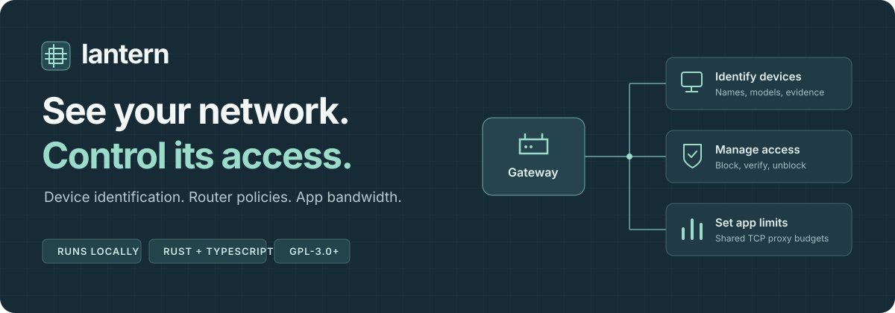

<p align="center">
  
</p>

<h1 align="center">Your network, in one local workspace.</h1>

<p align="center">
  Identify devices. Manage router access. Set app bandwidth limits.<br>
  Free software that runs on your computer, in your existing browser.
</p>

<p align="center">
  <a href="#quick-start"><strong>Get started</strong></a> &nbsp;·&nbsp;
  <a href="#router-setup">Router setup</a> &nbsp;·&nbsp;
  <a href="#development">Development</a> &nbsp;·&nbsp;
  <a href="VALIDATION.md">Validation</a> &nbsp;·&nbsp;
  <a href="LICENSE">GPL-3.0-or-later</a>
</p>

---

## At a glance

| Identify | Control | Shape |
| :--- | :--- | :--- |
| **Know what's connected.**<br>Offline manufacturer lookup, discovered names, advertised models, and evidence for conflicting labels. | **Make access decisions visible.**<br>Supported router blocks, policy readback, Wi-Fi association checks, and explicit unblock controls. | **Give apps a bandwidth budget.**<br>Local SOCKS5 profiles with shared upload/download limits and live TCP transfer counters. |

One Rust executable, a TypeScript interface, and local connections to your gateway. No account, cloud backend, telemetry, or Electron runtime.

> [!NOTE]
> **Credentials stay in memory. Router policies can outlive the app.** Closing Lantern does not remove an installed router block.

## Quick start

```sh
git clone https://github.com/leofratu/lantern.git
cd lantern
cargo run --release --locked
```

Lantern opens its local address in your browser. It binds to `127.0.0.1`, makes no router changes at startup, and needs no administrator privileges on your computer.

| Required | When |
| :--- | :--- |
| **Rust 1.91+** and your platform's C/C++ linker | Building the executable |
| **An existing browser** | Using the interface |
| **OpenSSH Client**: `ssh` and `ssh-keyscan` | Managing routers over SSH |
| **Node.js 22+** | Editing or rebuilding the interface only |

<details>
<summary><strong>Launch options and platform notes</strong></summary>

Generated JavaScript is included, so an ordinary Rust build does not need Node. On Windows, install the optional **OpenSSH Client** feature if its commands are missing.

```sh
# Choose a fixed local port and open the browser yourself.
cargo run --release --locked -- --port 4177 --no-open
```

The compiled binary is `target/release/lantern` on macOS/Linux or `target/release/lantern.exe` on Windows. Stop it with Ctrl+C. The included `Lantern.command` launcher uses an existing Apple Silicon release build when available and otherwise starts Cargo.

</details>

## Compatibility

| Environment | Status |
| :--- | :--- |
| **macOS · Apple Silicon** | Native optimized build and API checks passed |
| **Linux · x86-64** | Build, API, and isolated nftables checks passed |
| **Windows** | Source support; native validation pending |
| **Movistar Askey RTF8115VW REV5** | Live adapter checks on firmware `ES_g14.17_RTF_TEF001_V9.17_V034` |
| **OpenWrt** | Isolated firewall checks passed; physical radio validation pending |

Other router models and firmware need validation. See [what was actually tested](VALIDATION.md).

<details>
<summary><strong>Compare capabilities by gateway</strong></summary>

| Capability | Movistar Askey RTF8115VW | OpenWrt | Without a managed gateway |
| --- | --- | --- | --- |
| Inventory | Local router map | DHCP leases and neighbors over SSH | Computer's IPv4 neighbor cache |
| Identification | Manufacturer, targeted hostname/service/model inspection | Same | Same |
| Router information | Firmware, model, SSIDs, authorization, signal | Not exposed by the current adapter | Not available |
| Block a device | Native MAC blacklist; remains after Lantern exits | Runtime nftables forwarding rule; clears on gateway reboot | Not available |
| Verify a block | Fresh policy readback and two successive checks of both Wi-Fi radios | Rule, hook, match, drop action, traffic counters | Not available |
| Unblock an absent device | From the router blacklist | From the rules list | Not available |
| Disconnect once | Native command and radio readback | hostapd disconnect, requested 60-second ban | Not available |
| App bandwidth limits | Local SOCKS5 TCP proxy profiles | Same | Same |
| Device upload/download caps | No verified rate-cap API | MAC-based netdev rate policies, counters, and removal | Not available |

</details>

---

## Router setup

### Movistar Askey

1. Open **Gateway settings**, select **Movistar**, and enter the private IPv4 address and router administration password. This password may differ from the Wi-Fi password.
2. Inspect the SSH fingerprint. Verify it against the gateway you administer before selecting the trust checkbox. Lantern pins that identity on every connection and stops if it changes.
3. Connect. Open **Router information** to read firmware and both radio association lists.
4. Open **Inspect gateway rules** to retrieve the current blacklist, including entries created outside Lantern.

The adapter uses the existing `1234` administration account. Native management writes can take tens of seconds; controls remain busy during the operation. Do not run another policy editor simultaneously.

#### Block until unblocked

Select **Details → Block until unblocked**, review the MAC, and confirm.


<details>
<summary><strong>What happens when you confirm a block</strong></summary>

Lantern performs these steps:

1. Reads the current blacklist through authenticated SSH.
2. Adds only the selected MAC with native `add mac_blocked`. An existing entry is reused.
3. Enables blacklist mode only when explicitly confirmed. This router disables whitelist mode when enabling its blacklist. If a disabled blacklist contains unrelated addresses, Lantern refuses to activate it because those devices would also be blocked.
4. Reads the policy in a new SSH session and checks that unrelated entries were preserved.
5. Sends the native disconnect command to end an existing association.
6. Allows up to four radio checks for the filter to settle, requires two consecutive complete observations of absence, then reads the blacklist again.

</details>

The router holds the policy without a timer or a Lantern keepalive process. Closing Lantern does not remove it. Live checks read the policy through fresh SSH sessions rather than relying on Lantern's memory.

> [!IMPORTANT]
> Router power-cycle durability has **not** been tested. An ISP configuration replacement, factory reset, firmware behavior, or another administrator can change the policy.

#### Read the result

| Result | Evidence | Meaning |
| --- | --- | --- |
| Block verified | Enabled blacklist contains the MAC; both radios omit it in two successive complete reads | Policy installed; selected MAC absent from this router's Wi-Fi associations during verification |
| Policy verified, connection unverified | Enabled blacklist contains the MAC; radio checks are incomplete or still show it | Policy remains installed; disconnection is not claimed |
| Failed or unknown | Rejected command, timeout, malformed response, missing entry, changed mode, or concurrent policy change | Inspect live policy before retrying; a write may have partially applied |
| Unblock verified | Fresh session confirms the entry absent and other entries and mode unchanged | This blacklist no longer restricts the MAC; other router settings can still prevent connection |

**Inspect gateway rules → Verify again** retrieves current policy and association evidence. That radio result is a fresh single observation, not continuous monitoring. A radio list counts as complete only when its API explicitly reports success.

#### Unblock a device

Use **Details → Unblock**, or select **Unblock** beside the MAC in **Inspect gateway rules**. The second route works even when the device has disappeared from inventory. Lantern uses `remove mac_blocked`, verifies absence in a new session, and preserves other entries and the global mode. Removing the final entry leaves blacklist mode enabled with an empty list.

<details>
<summary><strong>Recovery from the router's SSH interface</strong></summary>

If Lantern is unavailable, connect using your SSH client, the existing administration account, and a verified host key. Replace this synthetic MAC with the intended device:

```text
show blacklist
remove mac_blocked 02:00:00:00:00:01
show blacklist
```

Some firmware requires connection-specific legacy RSA host-key compatibility. Keep that setting scoped to this router. Never disable host-key verification to work around an identity mismatch.

</details>

#### Scope of a MAC block

A MAC block applies to that address on the managed router. It cannot follow a device that changes its private MAC, uses another interface or gateway, or spoofs an address. Verification concerns this router's Wi-Fi radios; wired enforcement and every forwarding/offload path have not been independently measured. A silent device or an old DHCP lease alone does not prove blocking.

**Disconnect once** is a separate action. Its acknowledgement does not install a blacklist entry, and the device can reconnect immediately.

### OpenWrt

Configure key-based SSH access outside Lantern and verify the host key with your normal client. Select **OpenWrt** in Gateway settings, enter the private IPv4 address and username, and connect. The account needs access to leases, neighbors, nftables, and hostapd as applicable.

#### Device speed limits

Choose **Speed limit** on a device row, set upload and download values in Mbps, and confirm. These are device rate caps on the OpenWrt LAN interface, separate from the local app proxies. They require the device's traffic to pass through OpenWrt, `ip-full` with JSON support, nftables with netdev ingress/egress support, and a kernel supporting both hooks. Lantern refuses to install caps while OpenWrt flow offloading is enabled or a flowtable is present; it does not change those global settings automatically.

The adapter resolves the device's directly connected route and verifies its current neighbor MAC before writing. It installs separate source-MAC ingress and destination-MAC egress rules in an owned `netdev lantern_rate_v1` table. Readback verifies the match, byte rate, 16 KiB burst, drop action, counters, hook, and device binding. Other device limits are preserved. IPv4 and IPv6 frames using the selected MAC share the corresponding directional budget.

Excess packets are dropped above the budget. This is policing, not smooth queue shaping; packet bursts and TCP recovery affect observed transfer rates. Hardware/driver behavior and traffic that bypasses the selected interface still require physical validation. These runtime rules clear on gateway reboot.

Use **Inspect speed limits** to read current caps and dropped-byte counters, edit values, or remove both directions. This also works after a device vanishes from inventory. If an altered rule prevents safe automatic editing, an administrator can inspect and delete only `table netdev lantern_rate_v1` to remove all Lantern device caps. Other router policies remain separate.

<details>
<summary><strong>Firewall behavior, rule lifetime, and recovery</strong></summary>

Blocks use a dedicated `inet lantern_v1` nftables table with ownership marker `Managed by Lantern v1`. An early forward hook at priority `-10` drops packets matching the selected Ethernet source MAC and records packet/byte counters. Lantern refuses an existing table without its marker and does not flush other tables. JSON output support is required in the gateway's `nft` build.

Rules affect forwarded IPv4/IPv6 packets seen by the gateway. They do not remove Wi-Fi association, prevent same-segment switched traffic, or guarantee interruption of offloaded flows. Zero counters are inconclusive.

These rules clear on gateway reboot. Closing Lantern does not remove them. Reconnect and inspect rules to remove a block, including for an absent device. An administrator can also inspect and delete the dedicated `inet lantern_v1` table to remove all Lantern forwarding rules.

Wi-Fi disconnect uses authenticated `ubus hostapd.* del_client` calls, requests a 60-second reconnect ban, and reads the affected radios afterward. Physical OpenWrt radio interruption still needs hardware validation; firewall behavior has been tested against a real isolated Linux nftables namespace.

</details>

---

## Device identification

Every device row has **Ban**, **Unban**, **Ping**, **Speed limit**, and **Details** controls. Ban/Unban require a supported gateway connection; device speed caps require OpenWrt. Access badges explicitly show **Banned**, **Not banned**, or **Unknown**, with a router-read timestamp. **Refresh ban status** reads current policy; OpenWrt status covers Lantern's forwarding rules, while Movistar status covers its native blacklist. Other router restrictions can still apply.

Ping sends three ICMP requests from your computer and displays replies, packet loss, and round-trip times. A missing ICMP reply is not proof that the device is offline or blocked. Narrow windows keep controls beside each device instead of hiding them off-screen.

Lantern combines observations instead of treating a hostname as an authenticated identity:

- An embedded IEEE MA-L registry resolves interface manufacturers without uploading addresses. Private MACs do not receive manufacturer guesses. See [registry attribution](data/README.md).
- Targeted DNS/mDNS, DNS-SD, SSDP/UPnP, and HTTP inspection can reveal names, services, models, and explicitly advertised versions. Discovery does not sweep a subnet.
- Conflicting router labels and discovered names remain visible with their sources.
- The local computer is identified from its actual local route address. On macOS, the app reads the hardware model and macOS version locally.
- Firmware is displayed only when explicitly exposed. Protocol versions, model numbers, and HTTP banners are not relabeled as firmware.

Connect and refresh inspect up to 32 observed devices, four at a time, with a five-second budget per device. Results are cached for ten minutes within the session and retained only when MAC, IP, and router name still match. **Inspect device again** requests a fresh observation. Sleeping devices and devices exposing little metadata can remain unidentified.

## App bandwidth

1. Create an **App bandwidth** profile with upload and download limits.
2. In the application, select **SOCKS5**, host `127.0.0.1`, and the profile's displayed port. Enable proxy DNS if supported.
3. TCP connections through that profile share its directional limits. Counters show transferred bytes, active connections, and failures. Limits can be edited while running.

Substitute the displayed port for a command-line check:

```sh
curl --socks5-hostname 127.0.0.1:PROFILE_PORT https://example.com/
```

This is explicit proxy routing. It does not automatically intercept processes, shape UDP/QUIC, or control apps that bypass the proxy. There is no TLS interception or payload logging. Stopping a profile closes existing connections; remove the app's proxy setting to restore direct access.

Loopback proxy ports do not authenticate local users. Other processes can use a known port; profiles are not a security boundary between local accounts.

## Development

<details>
<summary><strong>Source map and runtime design</strong></summary>

```text
src/main.rs          Loopback API, authorization, operation serialization
src/router.rs        Movistar HTTP telemetry and OpenWrt adapter
src/movistar_cli.rs  Pinned SSH, scoped blacklist changes, strict readback
src/identity.rs      Targeted identification and offline manufacturer lookup
src/discovery.rs     Platform neighbor-cache discovery
src/reachability.rs  Bounded ICMP checks for observed private IPv4 devices
src/limits.rs        OpenWrt device rate policies, ownership, and readback
src/proxy.rs         SOCKS5 relay, shared pacing, connection lifecycle
src/model.rs         Shared models and boundary validation
web/                 TypeScript, generated JavaScript, local styles
tests/               Real-service API and isolated nftables checks
data/                Embedded IEEE registry and attribution
```

The backend uses Tokio with two worker threads and bounded waits. It allows at most 16 profiles and 128 proxy connections, with fixed 16 KiB directional buffers. Pacing budgets are shared per profile. These are implementation limits, not benchmark results.

</details>

### Build and check

After editing the interface, rebuild it and then Rust: the executable embeds the frontend.

```sh
npm ci --ignore-scripts
npm run check
npm run format:check
npm run build
cargo fmt -- --check
cargo clippy --all-targets --locked -- -D warnings
cargo test --locked
cargo build --locked
python3 tests/api_smoke.py target/debug/lantern
```

Use `target/debug/lantern.exe` in the last command on Windows. Python 3 is required for integration scripts. The API smoke suite does not contact a router.

<details>
<summary><strong>Linux firewall integration</strong></summary>

On Linux, run the firewall integration in its own user/network namespace:

```sh
python3 tests/gateway_namespace.py target/debug/lantern
python3 tests/rate_namespace.py target/debug/lantern
```

It requires `unshare`, `ip`, `nft`, and unprivileged user namespaces. It refuses the host network namespace and substitutes only SSH transport; firewall responses come from the isolated kernel. Never substitute a production router for this environment.

</details>

## Security and operation

| Boundary | Behavior |
| :--- | :--- |
| **Local interface** | Loopback binding, session API token, exact Host/Origin checks |
| **Router identity** | Pinned SSH host key; stop on identity changes |
| **Session data** | Credentials, inventory, profiles, and activity kept in memory |
| **Router policy** | Separate from the app session; inspect before retrying an uncertain write |

<details>
<summary><strong>Transport, local data, and concurrent administration</strong></summary>

The HTTP service binds only to IPv4 loopback. API requests require a random session token and exact Host/Origin checks. The UI uses a restrictive Content Security Policy, escaped device text, no CDN assets, and capped request bodies. Router responses and subprocess output are bounded.

Movistar web management uses LAN HTTP: credentials traverse the LAN without TLS. Use a trusted network. Outbound proxies and redirects are disabled. SSH pins the host key and supplies the password through an internal askpass process without a password argument or credential file.

Inventory, credentials, profile settings, and the latest 100 activity events are in memory and disappear on exit. Router policies are separate and can outlive the session. There is no durable audit log or guarantee of forensic memory erasure.

Writes are serialized inside one Lantern process and guarded in the UI. Multiple instances and other router editors do not share that lock. Transport failure after a write leaves the result unknown; inspect the router before retrying. Repeating a block or unblock is idempotent when the policy is unchanged.

</details>

### Current limits

Native installers, automatic updates, native process interception, smooth router queue shaping, local proxy UDP shaping, continuous monitoring, and universal firmware discovery are not implemented. Movistar device rate caps remain unavailable; the OpenWrt adapter requires a separate compatible gateway in the traffic path.

## License

GPL-3.0-or-later. See [LICENSE](LICENSE) and [third-party attribution](THIRD_PARTY.md). No proprietary NetCut or HelmoCut code, credentials, label photographs, or live client inventory fixtures are included.

<p align="center">
  <a href="#your-network-in-one-local-workspace">Back to top ↑</a>
</p>
